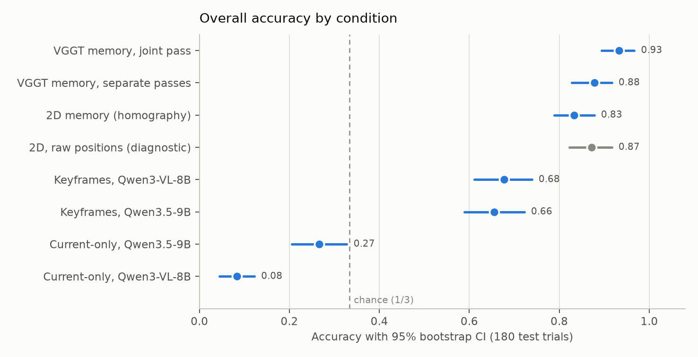
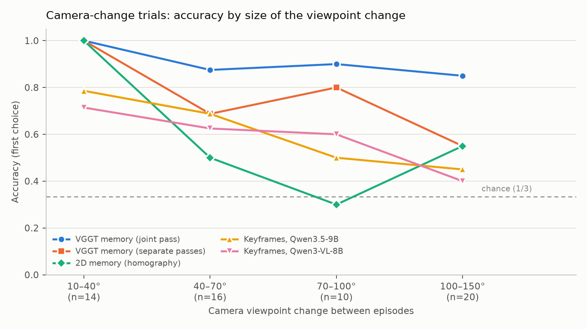

# Results: persistent containment memory for hidden-object localization

Test-set evaluation of the four conditions from the research plan (*Actor-Agnostic Persistent
Object Memory for Hidden-Object Localization*). Run on 2026-10-17. Development history and pilot
findings are in [FINDINGS.md](FINDINGS.md).

## Summary

- **Explicit memory beats frame-based VLM baselines (RQ1).** Every memory variant beats a VLM given
  keyframes, by +0.18 to +0.28 accuracy (all p_holm < 0.001). Without any history (current-only) the
  VLMs are at or below chance.
- **3D grounding helps only when VGGT aligns the views itself (RQ2).** With an unobserved camera
  change, the VGGT memory that reconstructs old and new frames in **one joint pass** beats the 2D
  memory by **+0.30** [+0.18, +0.43]. Running VGGT separately per episode and aligning the two
  reconstructions with classical feature matching gives a smaller, non-significant gain
  (+0.13 [0.00, +0.27]).
- **H2 is not supported.** The joint-pass advantage does not grow steadily with the size of the
  viewpoint change; it is present at every angle from about 40° on.
- **Ceiling from perception.** About 8 % of trials fail for every memory because the shared
  perception does not track the target cover at the end of episode 1.

## Setup

**Task.**
- *Episode 1:* a small yellow ball is visible on a table, and an invisible external actor lowers one
  of three upside-down mugs over it.
- *Between episodes (unobserved):* nothing happens, the camera orbits by 10–150°, or one mug moves
  10–35 cm so that its left/right order changes.
- *Episode 2:* the system must say which of the numbered mugs in the final image hides the ball.

**Data.**
- 180 test trials recorded in ManiSkill3 on the laptop, all passing the validity checks (ball visible
  at the start, hidden at query time, all mugs visible).
- 2 appearances (identical mugs / three colours) × 3 motion conditions × 30 trials, spread over
  three scenes with their own textured rooms and distractor objects.
- Seeds from 1,000,000, disjoint from the pilot.

**Shared perception** (identical for all conditions; RGB only, no simulator data):
- YOLOE-11L text-prompted detection;
- tracking within each continuously observed segment;
- detection of the covering event;
- ≤5 event-triggered keyframes;
- numbered candidate mugs in the query image.

Prompts were tuned on pilot data and then frozen.

**Conditions.**

| Condition | How it answers |
|---|---|
| Current-only | VLM sees only the numbered query image. |
| Keyframes | VLM sees ≤5 event keyframes plus the numbered query image. |
| 2D memory | Stores the mugs' image footprints. After the change, it registers the table plane with a homography (SIFT on the masked background, best before/after frame pair) and assigns old to new mugs by position + colour (Hungarian). |
| VGGT memory, separate passes | One VGGT reconstruction per episode. The two are aligned with SIFT background matches lifted to 3D + RANSAC similarity transform; then 3D assignment. |
| VGGT memory, joint pass | Old and new frames go through **one** VGGT forward pass, so they share one 3D frame without explicit matching; then 3D assignment. |

- Memory conditions answer by direct lookup (no VLM).
- VLMs: Qwen3.5-9B (primary) and Qwen3-VL-8B-Instruct, both in 8-bit, greedy decoding, thinking off.
  If a reply is free text, a second turn asks for the bare number.
- Hardware: a 20 GB slice of an H100. VGGT and the VLMs run sequentially.

**Scoring.**
- First-choice accuracy; "unknown" counts as wrong. Chance is 1/3.
- 95 % CIs from a bootstrap that resamples trials within scenes.
- RQ1 contrasts are paired and Holm-corrected.
- H2 is tested as the memory × angle interaction in a logistic regression.

## Overall accuracy

| Condition | Accuracy [95 % CI] |
|---|---|
| VGGT memory, joint pass | **0.93** [0.89, 0.97] |
| VGGT memory, separate passes | 0.88 [0.83, 0.92] |
| 2D memory (homography) | 0.83 [0.79, 0.88] |
| *2D, raw image positions (diagnostic)* | *0.87 [0.82, 0.92]* |
| Keyframes, Qwen3-VL-8B | 0.68 [0.61, 0.74] |
| Keyframes, Qwen3.5-9B | 0.66 [0.59, 0.72] |
| Current-only, Qwen3.5-9B | 0.27 [0.21, 0.33] |
| Current-only, Qwen3-VL-8B | 0.08 [0.04, 0.12] (mostly answers "unknown") |

## By cell (n = 30 each)

| Cell | 2D | 2D raw | VGGT sep. | VGGT joint | KF Qwen3.5 | KF Qwen3-VL |
|---|---|---|---|---|---|---|
| identical / fixed | 0.93 | 0.93 | 0.93 | 0.93 | 0.90 | 0.80 |
| identical / camera | 0.53 | 0.63 | 0.60 | **0.87** | 0.53 | 0.53 |
| identical / mug moved | 0.93 | 0.93 | 0.93 | 0.93 | 0.50 | 0.43 |
| distinct / fixed | 0.93 | 0.93 | 0.93 | 0.93 | 0.73 | 0.90 |
| distinct / camera | 0.67 | 0.80 | 0.87 | **0.93** | 0.67 | 0.60 |
| distinct / mug moved | 1.00 | 1.00 | 1.00 | 1.00 | 0.60 | 0.80 |

- With a fixed scene the VLMs are competitive. When a mug moves, they fall to 0.43–0.50 with identical
  mugs, while every memory stays at the perception ceiling.
- With camera changes, only the VGGT joint pass stays near the ceiling.

## By size of the viewpoint change (camera trials)

| Change | n | 2D | 2D raw | VGGT sep. | VGGT joint | KF Qwen3.5 | KF Qwen3-VL |
|---|---|---|---|---|---|---|---|
| 10–40° | 14 | 1.00 | 1.00 | 1.00 | 1.00 | 0.79 | 0.71 |
| 40–70° | 16 | 0.50 | 0.81 | 0.69 | 0.88 | 0.69 | 0.62 |
| 70–100° | 10 | 0.30 | 0.60 | 0.80 | 0.90 | 0.50 | 0.60 |
| 100–150° | 20 | 0.55 | 0.50 | 0.55 | 0.85 | 0.45 | 0.40 |

- The 2D memory fails from about 40° on: few or false background matches on the foreshortened,
  repetitively textured table.
- Raw image positions break down above ~100°, where the left/right order of the mugs flips.
- The separate VGGT passes inherit the classical-matching weakness at 100–150°.
- The joint pass stays at 0.85–0.90 across all larger changes.

## Research questions

| | Contrast | Difference [95 % CI] | p |
|---|---|---|---|
| RQ1 | 2D memory − keyframes (Qwen3.5) | +0.18 [+0.09, +0.26] | < 0.001 (Holm) |
| RQ1 | VGGT separate − keyframes | +0.22 [+0.15, +0.29] | < 0.001 (Holm) |
| RQ1 | VGGT joint − keyframes | +0.28 [+0.21, +0.35] | < 0.001 (Holm) |
| RQ2 | VGGT joint − 2D, camera change | **+0.30 [+0.18, +0.43]** | < 0.001 |
| RQ2 | VGGT separate − 2D, camera change | +0.13 [0.00, +0.27] | 0.08 |
| RQ2 | any VGGT − 2D, fixed / mug moved | 0.00 | – |
| H2 | VGGT joint vs 2D × angle (log-odds per 100°) | +1.23 [−0.66, +3.18] | n.s. |
| H2 | VGGT separate vs 2D × angle | −0.01 [−1.49, +1.69] | n.s. |

**Interpretation.**
- RQ1 holds: explicit containment memory beats VLMs with the same visual history, most clearly when a
  container moves while unobserved.
- RQ2 holds for the joint pass. Its advantage comes from VGGT's learned multi-view alignment of
  temporally separated frames, not from adding depth to classical 2D matches: the separate-pass
  variant, which relies on SIFT for cross-view alignment, gains much less.

## Perception (shared by all conditions)

| Measure | Test set |
|---|---|
| Covering detected | 0.99 |
| Correct parent mug inferred | 0.92 |
| Exactly three candidates in the query image | 0.92 |
| Correct mug among the candidates | 1.00 |

- The ground-truth-containment diagnostics (0.82 for 2D, 0.92 for the joint pass) do not exceed the
  perception-based results. The perception failures are cases where the target mug is not tracked at
  the end of episode 1, which the diagnostic cannot repair.
- The ~0.93 ceiling in the fixed and mug-moved conditions is therefore a perception limit, not a
  memory limit.

## Related work and novelty (literature check, 2026-10-18)

A targeted search (about 15 queries; arXiv abstracts/HTML; not a systematic review) found **no
paper reporting this combination**: one joint VGGT pass over temporally separated frames, used for
container re-identification and hidden-object localization across unobserved 10–150° viewpoint
changes, compared against 2D registration and VLM-keyframe baselines. The individual ideas do
have precedents.

| Work | Relation to this study |
|---|---|
| **VGGT-CD** (Zhang et al., arXiv 2605.16859, 2026) | **Closest precedent for the joint pass.** Runs before/after keyframes through VGGT jointly to get a shared frame and scale for 3D change detection. Shows that independent per-epoch reconstructions are badly mis-registered (registration error, not object accuracy). No objects, memory or containers. |
| **SOMA** (Li et al., arXiv 2605.22283, ICML 2026) | Closest **VGGT object memory** for robots (out-of-view objects, 3D boxes). Objects are not inside containers; assumes a static scene and small viewpoint changes; no joint-vs-separate comparison. |
| **GOLDILOCS** (Friedlander et al., ICLR 2026) | Object-level change detection from images taken at different times with feed-forward 3D reconstruction. No memory or hidden objects. (Only an abstract snippet was read.) |
| **VET-Bench** (Liu & Lee, arXiv 2603.08436, 2026) | Shows that VLMs are near chance at tracking identical objects (shell game), while explicit tracking succeeds. Our RQ1 is consistent with it. No 3D, no viewpoint change. |
| **Ledger** (Dieudonné et al., arXiv 2609.34554, 2026) / **RoboMME** | External 2D object memory for a VLA, including containment (drawers). No 3D, no viewpoint changes. |
| **Tracking Is Not Permanence** (Xie & Alanwar, arXiv 2610.07355, 2026) | Video world models lose objects carried inside moving containers, which is our cover-moved case. No 3D memory. |
| Others | 3DGS-CD (2411.03706), SceneVGGT (2602.15899), Embodied VideoAgent (2501.00358), RoboRetriever (2508.12916), FOUND-IT (2605.25371): related but different. |

**How to frame the contribution:**
- It is not a new mechanism. Joint feed-forward reconstruction across time is VGGT-CD's idea and must
  be credited.
- It is a new **application and controlled evaluation**: the joint pass applied to hidden-object
  containment memory.
- Its accuracy-level joint-vs-separate ablation (+0.30 vs +0.13 over 2D under camera change) is, to
  our knowledge, the first measured on an object-level task rather than as registration error.

These references are not yet in the research plan's bibliography and should be checked against the
full papers before citing.

## Limitations and deviations

1. **The 2D baseline is weaker than necessary.** It scores below raw image positions (0.83 vs 0.87)
   because false homographies on the repetitive wood grain are not rejected. A plausibility check is a
   known, unimplemented fix, so the RQ2 margin is likely somewhat inflated.
2. **Protocol deviation in the VLM baselines.** The first test run cut replies off after 8 tokens;
   Qwen3.5-9B answers the keyframe prompt with a sentence, so it scored 0.00. After seeing these
   outputs, the generation budget was raised to 128 tokens and an answer-extraction turn was added,
   identically for both models and conditions; only the VLM stage was re-run. First-run results are
   kept (`out/test/results_run1_truncated` on the cluster).
3. **H2 is underpowered.** 60 camera trials spread over 10–150°, about 10–20 per angle bin.
4. **Static-scene assumption.** The joint pass also runs when a mug moved, which violates VGGT's
   static-scene assumption. It still reaches 0.93/1.00 there, likely because the static background
   dominates.
5. **Scope.**
   - Simulation only, one task family (covers lowered over an object on a tabletop).
   - Perception prompts are tuned to the scene objects.
   - The VLMs are 8–9B models in 8-bit; larger models did not fit on the GPU slice.
   - Thresholds were set in simulation; transfer to real cameras is untested.

## Reproducibility

- **Code:** `sim/` on branch `worktree-pilot-seed-split`.
  - `run_pilot.py --split test --per-cell 30 --protocol-frozen` records the test set.
  - `run_all.py --data out/test --vlm Qwen/Qwen3.5-9B Qwen/Qwen3-VL-8B-Instruct --load-in-8bit` runs
    the evaluation.
  - `plot_results.py` makes the figures.
- **Results:** `results/test_summary.json` and `results/test_report.html`. Per-trial results are on the
  cluster under `~/hidden-object/sim/out/test/results/trials/`.
- **Runtime on the 20 GB H100 slice:**
  - perception 4.5 min;
  - 2D 15 min;
  - VGGT (both variants) 44 min;
  - VLMs 59 min.
